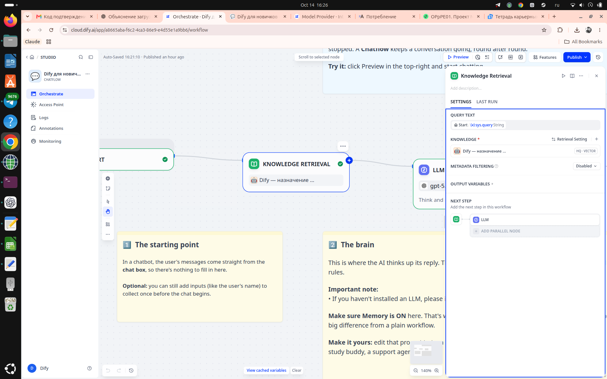

# Dify-ассистент для новичков

Практический кейс проектирования базы знаний для RAG-ассистента: от пользовательских вопросов и атомарных фактов до Parent-Child документов и минимального Chatflow в Dify.

**[Открыть ассистента](https://udify.app/chat/f6PaUk9HZesp0r7O)**

## Главный тезис

В RAG-ассистенте качество ответа во многом определяется не сложностью workflow, а тем, насколько хорошо база знаний спроектирована под пользовательские задачи и последующий поиск.

В этом проекте основная работа была выполнена до запуска модели:

1. Зафиксированы вопросы, боли и решения пользователей.
2. Из официальной документации собраны проверяемые атомарные факты.
3. Факты объединены в смысловые темы.
4. Для каждой темы спроектирован родительский документ и его дочерние разделы.
5. Поиск и ответ проверяются на исходном наборе вопросов.

## Что получилось

- 37 пользовательских вопросов с болями, критериями решения, проверенными ответами и зафиксированными пробелами.
- Реестр атомарных фактов со ссылками на источники и связью с вопросами.
- 15 тематических Parent-Child документов.
- Простой Chatflow: `Start → Knowledge Retrieval → LLM → Answer`.
- Векторный поиск без reranking и Full-Text Search, `Top K = 3`.
- Цитирование источников через функцию Citations в Dify.

## Минимальный промпт — это результат, а не недостаток

В ходе работы сложные инструкции делали ответы более механическими и менее содержательными. После сокращения промпта качество выросло. В финальной версии промпт задаёт только роль, язык, принцип отбора релевантного контекста и честное поведение при нехватке данных.

Это не универсальное правило для любого AI-приложения, а наблюдаемый результат этого кейса.

## Архитектура

```text
Вопрос пользователя
        │
        ▼
Knowledge Retrieval
  поиск по child-разделам
  возврат parent-документов
        │
        ▼
LLM + минимальный prompt
        │
        ▼
Ответ + Citations
```

Каждый родитель хранится как отдельный Markdown-документ. Внутри него дочерние разделы отделены маркером `@@CHILD@@`.

### Chatflow



### Настройки Knowledge Base


Подробнее:

- [Методология](docs/methodology.md)
- [Выбор архитектуры базы](docs/knowledge-architecture.md)
- [Retrieval и Chatflow](docs/retrieval-and-chatflow.md)
- [Оценка и ограничения](docs/evaluation-and-limitations.md)

## Соответствие требованиям проекта

| Требование | Реализация |
| --- | --- |
| Текстовый AI-ассистент | Опубликованный Chatflow в Dify |
| Цель, роль и стиль | Зафиксированы в кратком системном промпте в [`dify/app.yml`](dify/app.yml) |
| Типовые сценарии | 37 исходных вопросов в [`evaluation/questions.xlsx`](evaluation/questions.xlsx) |
| Ограничения | Ассистент сообщает, когда материалов недостаточно; пробелы описаны в [`docs/evaluation-and-limitations.md`](docs/evaluation-and-limitations.md) |
| База знаний | 15 документов в [`knowledge-base/parents`](knowledge-base/parents) |
| Публичный доступ | [Открыть ассистента](https://udify.app/chat/f6PaUk9HZesp0r7O) |
| Интеграция | Публикация Dify поддерживает web app, embed и API |
| Обновление базы | Включено в [методологию](docs/methodology.md#обновление-базы) |
| Ссылки на источники | В Dify включена функция Citations |

## Структура репозитория

```text
docs/             методология, архитектурные решения и ограничения
knowledge-base/   финальные документы для загрузки в Dify
research/         реестр проверенных фактов и источников
evaluation/       исходные вопросы и проверочные сценарии
dify/             экспорт Chatflow и инструкция по запуску
assets/           скриншоты фактической конфигурации
```

## Как воспроизвести

1. Импортируйте [`dify/app.yml`](dify/app.yml) в Dify Studio.
2. Создайте Knowledge Base с Parent-Child chunking.
3. Загрузите в неё файлы из [`knowledge-base/parents`](knowledge-base/parents).
4. Настройте `@@CHILD@@` как разделитель дочерних чанков.
5. Подключите созданную базу в Knowledge Retrieval node.
6. Сверьте параметры с [`dify/import-and-run.md`](dify/import-and-run.md).
7. Прогоните вопросы из [`evaluation/test-cases.md`](evaluation/test-cases.md).

Экспорт приложения ссылается на внешнюю Knowledge Base по `dataset_id`, но не содержит саму базу и её активные retrieval-настройки. Поэтому базу нужно создать и подключить отдельно.

## Ограничения

- База знаний ограничена выбранными задачами новичков и не заменяет всю документацию Dify.
- Актуальность цен, квот, beta-функций и интерфейса нужно проверять перед ответом.
- Качество зависит не только от базы, но и от модели, retrieval, промпта и набора тестов.
- Это учебный проект; в нём используются только публичные и тестовые данные.

## Лицензия

Лицензия пока не выбрана. До её добавления все права на материалы сохраняются за автором.
