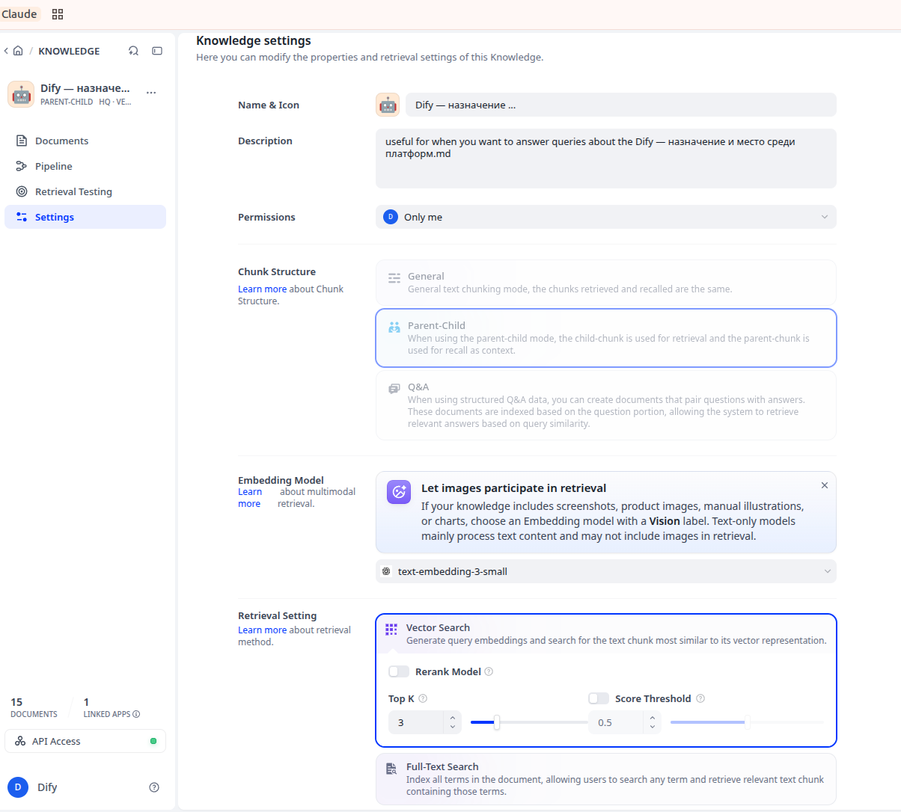

# Dify-ассистент для новичков

## Что это за продукт

Ассистент помогает новому пользователю быстро понять возможности и ограничения Dify, сравнить с другими AI решения, узнать о бесплатных возможностях.

Ассистент расскажет об основных инструментах Dify: Workflow, New Agent, Chatflow и даст рекомендации по архитектуре приложения.


**[Поговорить с ассистентом](https://udify.app/chat/f6PaUk9HZesp0r7O)**


## О проекте

Рабочий тезис проекта: в RAG-ассистенте качество ответа во многом определяется не сложностью workflow, а тем, насколько хорошо база знаний спроектирована под пользовательские задачи и последующий поиск.

В этом проекте основная работа была выполнена до запуска модели:

1. Зафиксирована цель ассистента, возможные вопросы и боли пользователей.
2. Из официальной документации собраны проверяемые атомарные факты, покрывающие вопросы.
3. Факты объединены в смысловые темы.
4. Собраны документы для базы знаний со структурой parent-child: для каждой темы спроектирован родительский документ и его дочерние разделы.
5. На основе исходных вопросов сформированы проверочные сценарии для retrieval и ответа.


## Архитектура
Решение реализовано на Dify.

### Chatflow

```text
Вопрос пользователя
        │
        ▼
Knowledge Retrieval
  поиск по child-разделам
  возврат parent-документов
        │
        ▼
LLM + минимальный prompt
        │
        ▼
Ответ + Citations
```


### Настройки Knowledge Base



Подробнее:

- [Методология](docs/methodology.md)
- [Выбор архитектуры базы](docs/knowledge-architecture.md)
- [Retrieval и Chatflow](docs/retrieval-and-chatflow.md)
- [Оценка и ограничения](docs/evaluation-and-limitations.md)

## Соответствие требованиям проекта

| Требование | Реализация |
| --- | --- |
| Текстовый AI-ассистент | Опубликованный Chatflow в Dify |
| Цель, роль и стиль | Зафиксированы в кратком системном промпте в [`dify/app.yml`](dify/app.yml) В ходе ручных итераций сложные инструкции делали ответы более механическими и менее содержательными. Поэтому оставлен короткий промпт: он задаёт роль, язык, принцип отбора релевантного контекста и честное поведение при нехватке данных.|
| Типовые сценарии | Репрезентативный набор в [`evaluation/test-cases.md`](evaluation/test-cases.md) |
| Ограничения | Ассистент сообщает, когда материалов недостаточно; пробелы описаны в [`docs/evaluation-and-limitations.md`](docs/evaluation-and-limitations.md) |
| База знаний | 15 документов в [`knowledge-base/parents`](knowledge-base/parents) |
| Публичный доступ | [Открыть ассистента](https://udify.app/chat/f6PaUk9HZesp0r7O) |
| Интеграция | Публикация Dify поддерживает web app, embed и API |
| Обновление базы | Включено в [методологию](docs/methodology.md#обновление-базы) |
| Ссылки на документы базы | В Dify включена функция Citations; она показывает документы Knowledge Base, использованные при ответе |

## Структура репозитория

```text
docs/             методология, архитектурные решения и ограничения
knowledge-base/   финальные документы для загрузки в Dify
evaluation/       проверочные сценарии для ревьюера
dify/             экспорт Chatflow и инструкция по запуску
assets/           скриншот фактических настроек Knowledge Base
```

## Как воспроизвести

1. Импортируйте [`dify/app.yml`](dify/app.yml) в Dify Studio.
2. Создайте Knowledge Base с Parent-Child chunking.
3. Загрузите в неё файлы из [`knowledge-base/parents`](knowledge-base/parents).
4. Настройте `@@CHILD@@` как разделитель дочерних чанков 2300 символов.
5. Подключите созданную базу в Knowledge Retrieval node.
6. Сверьте параметры с [`dify/import-and-run.md`](dify/import-and-run.md).
7. Прогоните вопросы из [`evaluation/test-cases.md`](evaluation/test-cases.md).

Экспорт приложения ссылается на внешнюю Knowledge Base по `dataset_id`, но не содержит саму базу и её активные retrieval-настройки. Поэтому базу нужно создать и подключить отдельно.

## Ограничения

- База знаний ограничена выбранными задачами новичков и не заменяет всю документацию Dify.
- Качество зависит не только от базы, но и от модели, retrieval, промпта и набора тестов.
